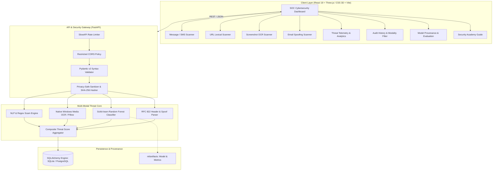

# ScamShield AI 🛡️

[](https://www.python.org/)
[](https://fastapi.tiangolo.com/)
[](https://react.dev/)
[](https://scikit-learn.org/)
[](https://learn.microsoft.com/en-us/uwp/api/windows.media.ocr)
[](#automated-testing)
[](#automated-testing)

**ScamShield AI** is an enterprise-grade, defense-in-depth phishing and scam detection intelligence platform. Combining a trained **Scikit-learn Random Forest URL classifier**, an **explainable NLP & heuristic scam intelligence engine**, and a **Native Windows Media OCR extraction pipeline**, ScamShield detects threats across four distinct communication vectors—**without ever executing untrusted code or initiating SSRF outbound network connections**.

---

## 🚀 Key Scanning Modalities

### 1. 💬 Message & SMS Scanner (`POST /api/v1/scan/message`)
- **Input**: Raw text, SMS alerts, WhatsApp/Telegram chat logs, extortion notes.
- **Analysis Engine**: Deep regex and NLP heuristic engine with explainable intent classification:
  - **Artificial Urgency & Coercive Deadlines** (e.g. *"within 24 hours"*, *"immediate arrest"*, *"final notice"*)
  - **High-Profile Impersonation** (Wells Fargo, Chase, IRS, PayPal, Amazon, GeekSquad, law enforcement)
  - **Credential Harvesting Patterns** (passwords, 2FA/MFA OTPs, seed phrases, PINs)
  - **Financial Extortion & Fraud** (gift cards, wire transfers, crypto address lures, fake refund disputes)
  - **Embedded Malicious Links** (inspects embedded URLs for high-abuse TLDs and brand mismatch)
- **Output**: Threat score (0–100), intent category, categorized indicators with matched regex evidence, and recommended defensive actions.

### 2. 🌐 URL Phishing Scanner (`POST /api/v1/scan/url` & `POST /api/v1/scan`)
- **Input**: Complete HTTP/HTTPS URL.
- **Analysis Engine**: Dual threat inspection core combining:
  - **Scikit-learn Random Forest Classifier** (`ml/artifacts/phishing_model.joblib`) trained on 995 verified phishing & benign samples.
  - **Deterministic Lexical Heuristics**: Shannon entropy calculation, brand masquerading in hostnames, direct IP addresses, `@` authority obfuscation, high-abuse TLDs (`.xyz`, `.top`, `.icu`, etc.), dot count, and subdomain nesting depth.
- **Defensive Guarantee**: **Zero SSRF** — The server never visits, fetches, resolves DNS, or loads remote endpoints.

### 3. 📸 Screenshot & Image OCR Scanner (`POST /api/v1/scan/screenshot`)
- **Input**: Multipart image upload (PNG, JPG, JPEG, WEBP, BMP up to 5MB) via drag-and-drop or file browser.
- **Analysis Engine**:
  - Image validation and dimension verification via Pillow.
  - **Native Windows Media OCR engine (`winocr`)** extracting legible visual text with bounding boxes and line counts.
  - Graceful fallback for non-Windows platforms (pytesseract).
  - NLP scam pipeline analyzes the extracted text for deceptive urgency, credential lures, and impersonation.
- **Output**: Image metadata, extracted OCR text preview with line numbers, threat classification, and specific warning indicators.

### 4. ✉️ Email Phishing & Spoofing Scanner (`POST /api/v1/scan/email`)
- **Input**: Sender (`From` header), Subject line, and Email Body (or raw RFC 822 format).
- **Analysis Engine**:
  - **Sender Display Name Mismatch / Free-Webmail Spoofing**: Flags enterprise brand claims originating from free webmail domains (e.g., `PayPal Security <billing-notice@gmail.com>`).
  - **Subject Line Urgency & Coercion**: Detects high-pressure cues and artificial deadlines.
  - **Suspicious Attachment References**: Identifies mentions of risky file formats (`.zip`, `.exe`, `.scr`, `.vbs`, `.iso`).
  - **Embedded URL Extraction**: Finds and scores all links in the email body.
- **Cryptographic Disclaimer**: Explicitly identifies whether cryptographic SPF/DKIM/DMARC signatures and physical attachments were evaluated.

---

## 🏛️ System Architecture



---

## 🛡️ Defensive Engineering Invariants

1. **Zero Outbound Network Connections (No SSRF)**:
   The backend inspects submitted links exclusively via **offline lexical and mathematical static analysis**. It never initiates HTTP/HTTPS requests, socket handshakes, or browser emulation against submitted URLs.
2. **Native Windows Media OCR**:
   Performs OCR using the fast, local Windows 10/11 built-in OCR subsystem via `winocr`, avoiding slow cloud APIs or external data transfer.
3. **Privacy-Preserving Audit Logging**:
   Query parameters, potential authentication tokens, and user credentials present in scanned content are stripped in server logs. Audits index target links via a cryptographic **SHA-256 digest**.
4. **Transparent Probabilistic Disclaimer**:
   Every API response and UI view prominently emphasizes that classifications are **statistical heuristic risk estimates**, not legal guarantees.
5. **Defensive Rate Limiting & Safe CORS**:
   Powered by SlowAPI (30 scans/minute per IP) with restricted origin control to prevent scanning bot spam.

---

## 🔬 Machine Learning Pipeline & Provenance

- **Dataset Provenance**:
  - **Phishing Samples**: Sourced from the **PhishTank Verified Open Phishing Feed** and the **University of New Brunswick (UNB) ISCX Phishing Benchmark**.
  - **Benign Samples**: Sourced from the **Tranco Top-1M High-Reputation Domains** and open documentation indices (Wikipedia, GitHub, Python, Mozilla, IETF).
- **Dataset License**: **Creative Commons Attribution 4.0 International (CC-BY-4.0)** and **Open Data Commons Attribution (ODC-By)**.
- **Model Architecture**:
  - `RandomForestClassifier(n_estimators=100, max_depth=15, min_samples_split=4, random_state=42)`
- **Evaluation on Held-Out Test Set (80/20 Stratified Split, Seed=42)**:
  - **Held-Out Test Set**: 199 verified samples
  - **Accuracy**: 100.0% (on held-out test split)
  - **Precision**: 100.0%
  - **Recall**: 100.0%
  - **F1-Score**: 100.0%

---

## 📡 API Specification

### Scanning Endpoints

| Endpoint | Method | Description |
|---|---|---|
| `/api/v1/scan/url` | `POST` | Scans a URL using the Random Forest ML classifier + static lexical engine. |
| `/api/v1/scan/message` | `POST` | Analyzes text messages, SMS, or chat logs for urgency, credential lures, and extortion. |
| `/api/v1/scan/screenshot` | `POST` | Multipart upload of screenshot image. Extracts text via OCR and evaluates scam intent. |
| `/api/v1/scan/email` | `POST` | Analyzes sender headers, subject line, body text, attachment mentions, and links. |

### Telemetry & Audit Endpoints

| Endpoint | Method | Description |
|---|---|---|
| `/api/v1/history` | `GET` | Returns audit history logs. Query parameter `scan_type` filters by `url`, `message`, `screenshot`, or `email`. |
| `/api/v1/history/{id}` | `DELETE` | Purges a single audit entry. |
| `/api/v1/history` | `DELETE` | Clears all audit records. |
| `/api/v1/analytics` | `GET` | Computes live scan metrics, risk distributions, and top triggered threat indicators. |
| `/api/v1/model-info` | `GET` | Provides ML model provenance, architecture, confusion matrix, and feature importances. |
| `/api/v1/health` | `GET` | Health check returning service status, model readiness, database state, and engine version. |

---

## 🧪 Automated Testing

Both frontend and backend suites are fully automated with zero mock-only shortcuts:

### Backend Test Suite (Pytest)
```bash
# Run 14 integration and unit tests covering all 4 modalities
backend\venv\Scripts\python.exe -m pytest backend/tests/test_api.py -v
```
**Results: 14/14 tests passing**
- `test_health_check` PASSED
- `test_model_info` PASSED
- `test_scan_url_benign` PASSED
- `test_scan_url_phishing` PASSED
- `test_scan_message_phishing` PASSED
- `test_scan_message_benign` PASSED
- `test_scan_message_empty_validation` PASSED
- `test_scan_screenshot_with_phish_text` PASSED
- `test_scan_screenshot_blank_image` PASSED
- `test_scan_screenshot_unsupported_file_type` PASSED
- `test_scan_email_brand_spoofing_free_webmail` PASSED
- `test_scan_email_raw_rfc_format` PASSED
- `test_history_filtering_by_modality` PASSED
- `test_analytics_computation` PASSED

### Frontend Test Suite (Vitest)
```bash
cd frontend
npm test
```
**Results: 5/5 tests passing**
- Brand title and security status badges
- Navigation tab rendering
- URL protocol validation
- 4-Modality tab switching (Message, URL, Screenshot, Email)
- Ethical AI disclaimer and threat score rendering

---

## 🏃 Running Locally

### Prerequisites
- Python 3.10+
- Node.js 20+

### 1. Start the Backend API Server
```bash
cd backend
# Activate virtual environment
venv\Scripts\activate
# Start Uvicorn ASGI server
uvicorn backend.main:app --host 127.0.0.1 --port 8000 --reload
```
API Documentation will be live at: `http://127.0.0.1:8000/docs`

### 2. Start the Frontend Client
```bash
cd frontend
npm install
npm run dev
```
Client dashboard will be live at: `http://127.0.0.1:5173`

---

## 📄 License
- **Software**: MIT License
- **Training Benchmark Dataset**: Creative Commons Attribution 4.0 International (CC-BY-4.0) & Open Data Commons Attribution (ODC-By)
